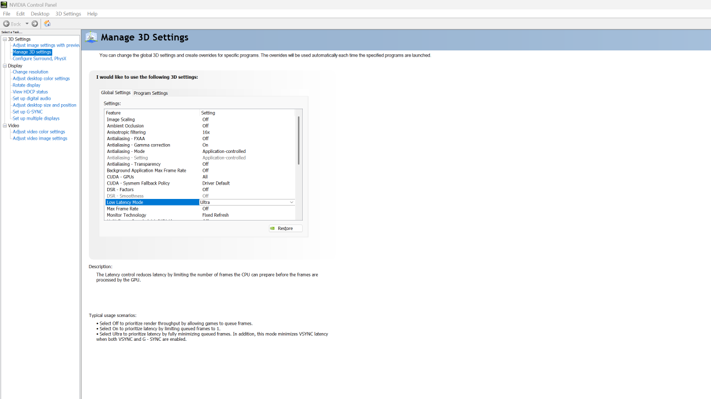
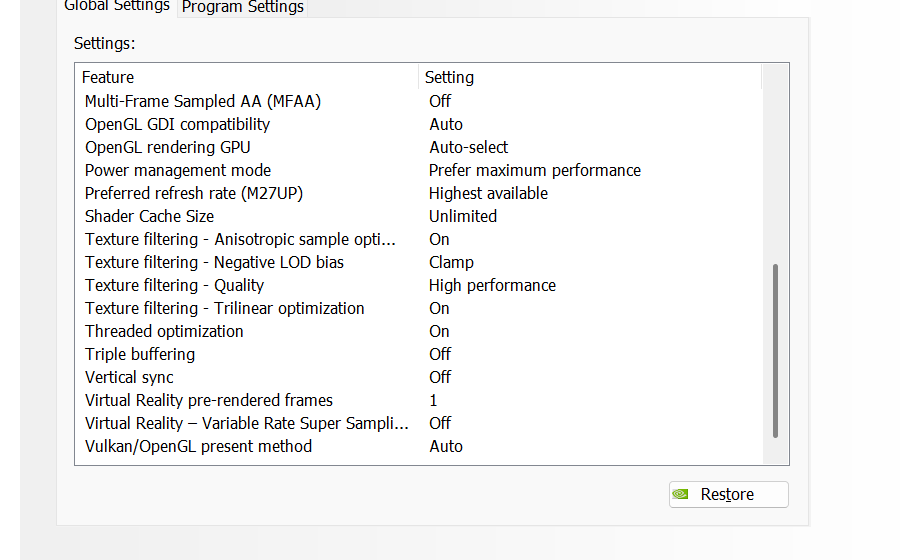
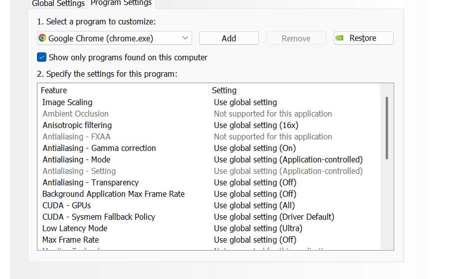

<div align="center">

# ⚡ nvmax

**One executable. Every NVIDIA setting at maximum performance. No clicks, no panel.**


</div>

`nvmax.exe` installs the latest **NVIDIA Control Panel**, forces the **global driver profile** to its maximum-performance values, tunes the matching Windows settings, then **re-reads every value from the driver** and prints a verification table. A full run takes about **3 seconds** and is idempotent: run it as often as you like, after every driver update, and it repairs whatever drifted.

## ✨ What it sets

| Area | Value |
|---|---|
| Power management mode | Prefer maximum performance |
| Low Latency Mode | **Ultra** (+ Ultra Low Latency flag, pre-rendered frames = 1) |
| Vertical sync / frame limiters | Off / none |
| Texture filtering | Quality = High performance, trilinear + anisotropic sample optimisation On |
| Anisotropic filtering | 16x, user defined |
| Shader cache | On, unlimited |
| Threaded optimization | On |
| Ambient occlusion / FXAA / MFAA / triple buffering | Off |
| Monitor Technology | Fixed Refresh (no G-SYNC cap) |
| CUDA | Sysmem fallback = *Prefer no sysmem fallback*, Force P2 state = Off |
| Windows | GPU scheduling, Game Mode and the power plan checked/forced |

43+ driver and Windows checks in total; see `src/main.rs` (`MAX_PERF`) for the exact list of setting IDs.

## 🚀 Install

Download **`nvmax.exe`** from the [latest release](../../releases/latest) and run it. It asks for administrator rights itself (UAC prompt), applies everything, and exits `0` when all checks pass.

```powershell
.\nvmax.exe            # install/update panel, apply every setting, verify
.\nvmax.exe verify     # read-only check, exit 1 on any mismatch
.\nvmax.exe dump       # list every driver setting id and value
.\nvmax.exe stored     # list what is actually stored in the base profile
.\nvmax.exe set ID VAL # force one driver setting (testing aid)
```

Example output ends with:

```
[OK] CUDA Sysmem Fallback Policy = Prefer no sysmem fallback: 1
[OK] Low Latency Mode (panel state) = Ultra: 2
---- 45 checks, 0 failed ----
```

## 🧠 How it works

1. **NVAPI DRS** (loaded dynamically from `nvapi64.dll`, no SDK needed) writes the documented profile settings.
2. A few settings (Low Latency Ultra, CUDA sysmem fallback, Force P2) are stored in the base profile but are *not* writable through a plain `DRS_SetSetting` call (it returns `-160`). For those, `nvmax` embeds [NVIDIA Profile Inspector](https://github.com/Orbmu2k/nvidiaProfileInspector) (MIT), extracts it to a temp folder, imports a generated `.nip`, deletes it, then reads the values back through `DRS_EnumSettings`.
3. Every value is verified; failed attempts are retried.

No screen automation, no mouse clicks, and the Control Panel is never launched by the run.

### Panel proof

| Global (top) | Global (scrolled) | Program Settings |
|---|---|---|
|  |  |  |

## 🛠 Build from source

```powershell
cargo build --release          # Rust 2024, zero crates, x86_64-pc-windows-gnu or msvc
cargo clippy --release -- -D warnings
```

`npi/nvidiaProfileInspector.exe` and its `.config` are embedded with `include_bytes!`; keep them in the repo.

## 🩹 Troubleshooting

- **Nothing happens / UAC declined** – run from an elevated shell or accept the prompt.
- **`verify` fails after a driver update** – just run `nvmax.exe` again.
- **Settings not visible in the panel** – restart the Control Panel; values live in the driver store.
- Legacy click-based panel driver is kept in `tools/legacy/` for reference only and is not used.

## 📜 License

MIT. NVIDIA Profile Inspector © Orbmu2k, MIT, redistributed unmodified.
